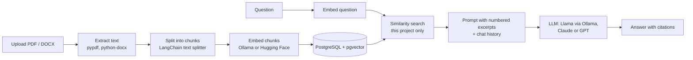

# Project Management Service

A FastAPI backend for creating, updating, sharing, and deleting projects and their attached documents, with an **AI document assistant** that answers questions about a project's files and cites its sources. The project demonstrates authentication, role-based project access, PostgreSQL persistence, document storage, Retrieval-Augmented Generation (RAG) with pgvector, a LangGraph tool-using agent, Docker, automated tests, and GitHub Actions CI.

## AI project assistant

Project members can ask questions such as *"When is the launch deadline?"* or *"Summarise the requirements doc"*. The assistant answers **only from that project's documents**, cites the file and page for each fact, and says so when the answer is not in the documents.



**Highlights**

- **RAG pipeline**: text extraction → chunking with overlap → embeddings → cosine-similarity search in PostgreSQL with **pgvector** → grounded answer with `[1]`-style citations.
- **LangGraph agent** (`mode: "agent"`): the model chooses between four tools (`search_documents`, `list_documents`, `read_document`, `get_project_info`) and can call several in a row, which handles summaries and comparisons that a single search cannot.
- **Free by default**: runs on a local **Llama 3.2** model through **Ollama**, with no API key or account. Claude (Anthropic) or GPT (OpenAI) can be switched on with one setting.
- **Graceful degradation**: if no language model is available, the assistant still returns the most relevant passages with their sources.
- **Security**: retrieval is always filtered by project, and agent tools are bound to one project in code, so the model cannot be prompted into reading another project's files. Document text is passed as data inside `<documents>` tags, and the prompt tells the model to ignore instructions found in documents (basic prompt-injection defence).
- **Context management**: chat memory per user and project (last `CHAT_HISTORY_TURNS` messages), a character budget for retrieved context, and follow-up questions rewritten with the previous question so retrieval still finds the right passages.
- **Monitoring**: every request logs latency, token use, retrieval score and whether a fallback was used; users can rate answers; `/stats` aggregates it all.
- **Evaluation**: `evaluation/eval_retrieval.py` measures hit@k and MRR on a labelled question set, so changes to chunking or embedding models are measured instead of guessed.
- **Tested without a model**: tests use deterministic fake chat models and keyword-hash embeddings, so CI runs offline in seconds and costs nothing.

See [`docs/AI_ASSISTANT_GUIDE.md`](docs/AI_ASSISTANT_GUIDE.md) for a walkthrough of how each part works and why it was designed that way.

## Stack

- Python 3.10 + FastAPI
- PostgreSQL + SQLAlchemy ORM + Alembic migrations
- uv for Python dependency and environment management
- Docker / Docker Compose
- S3-compatible document storage through boto3
- JWT authentication + bcrypt password hashing
- AI: LangChain, LangGraph, pgvector, Ollama (Llama 3.2, nomic-embed-text), optional Hugging Face sentence-transformers, Claude or OpenAI
- pytest with SQLite and mocked S3 for automated tests
- GitHub Actions for linting, unit tests, and Docker build verification

Real AWS deployment is not required to run or test this project. The S3 and Lambda code remains in the repository as part of the requested architecture and can be demonstrated locally/mocked.

## Main functionality

Users can register and log in, create projects, see projects they can access, update project information, upload PDF/DOCX documents, replace or delete documents, and share projects with other users.

A project has two roles:

- **owner** — the creator; can edit, delete, and invite users.
- **participant** — an invited user; can view/edit project information and manage documents, but cannot delete the project or invite users.

The creator automatically receives an OWNER `ProjectAccess` row when a project is created. Documents use the access rules of their parent project.

## Data model

- `users` — login and hashed password
- `projects` — project name, description, and owner
- `project_access` — connects users to projects and stores their role
- `documents` — document metadata and storage key
- `share_tokens` — hashed, expiring, single-use invitation tokens
- `document_chunks` — chunk text, page number and its embedding (`vector` column via pgvector)
- `chat_messages` — assistant conversation memory, per user and project
- `ai_request_logs` — one row per assistant request: latency, tokens, retrieval score, fallback, feedback

## Dependency management with uv

This project uses **uv** instead of pip/Poetry for dependency and virtual-environment management. Dependencies are declared in `pyproject.toml`.

Install uv by following the official uv documentation, then from the repository root run:

```bash
uv sync
```

Run application commands through uv, for example:

```bash
uv run pytest tests/ -v
uv run ruff check .
uv run black --check .
```

## Running locally with Docker

Create the local environment file first:

```bash
cp .env.example .env
```

Then run:

```bash
docker compose up --build
```

Docker Compose starts PostgreSQL (with pgvector), applies the Alembic migrations with `alembic upgrade head`, starts FastAPI, and starts **Ollama**. On the first start, the `ollama-pull` job downloads the chat model (`llama3.2`) and the embedding model (`nomic-embed-text`), about 2.3 GB in total. Wait until `docker compose logs ollama-pull` shows both downloads finished before asking questions. Later starts reuse the downloaded models.

A laptop with 8 GB of RAM or more is enough. If you already run Ollama natively (it is faster on a Mac), stop the `ollama` services and set `OLLAMA_BASE_URL=http://host.docker.internal:11434` in `.env`.

### Trying the assistant

1. Open `http://localhost:8000/docs`, register with `POST /auth`, log in with `POST /login`, and click **Authorize** with the token.
2. Create a project with `POST /projects` and upload a PDF or DOCX with `POST /project/{id}/documents`. Indexing runs in the background right after the upload.
3. Check `GET /project/{id}/assistant/status` until `indexed_documents` matches `documents`.
4. Ask with `POST /project/{id}/assistant/ask`:

```json
{ "question": "When is the launch deadline?", "mode": "rag" }
```

Use `"mode": "agent"` for questions that need several steps, for example *"Compare the payment terms in the two contracts"*.

### Choosing models

All AI settings live in `.env` (see `.env.example`).

| Setting | Options | Default |
|---|---|---|
| `LLM_PROVIDER` | `ollama` (free, local), `anthropic`, `openai`, `none` | `ollama` |
| `EMBEDDING_PROVIDER` | `ollama` (free, local), `huggingface`, `hash` | `ollama` |

- **Zero-install demo**: `LLM_PROVIDER=none` and `EMBEDDING_PROVIDER=hash` need no model at all. Answers are the most relevant passages with sources, matched by keywords.
- **Hugging Face embeddings**: `uv sync --extra huggingface`, then `EMBEDDING_PROVIDER=huggingface` (uses `sentence-transformers/all-MiniLM-L6-v2`). This installs PyTorch, so it is optional.
- **Claude or GPT** (paid APIs): set `LLM_PROVIDER=anthropic` with `ANTHROPIC_API_KEY`, or `LLM_PROVIDER=openai` with `OPENAI_API_KEY`. Never commit keys; `.env` is git-ignored.

After changing the embedding model, call `POST /project/{id}/assistant/reindex` (owner only), because vectors from different models cannot be compared. Search only uses chunks created by the currently configured model.

The API is available at `http://localhost:8000` and the interactive Swagger documentation is at `http://localhost:8000/docs`.

Do **not** generate another initial migration during normal setup; the repository already contains the initial migration.

## Running tests

```bash
uv sync
uv run pytest tests/ -v
```

Tests use an isolated in-memory SQLite database and mocked S3 through `moto`, so real PostgreSQL/AWS credentials are not needed for the test suite. AI tests use scripted fake chat models and keyword-hash embeddings, so no model download, API key or network access is needed.

## Evaluating retrieval

```bash
uv run python -m evaluation.eval_retrieval --verbose                          # configured embeddings
EMBEDDING_PROVIDER=hash uv run python -m evaluation.eval_retrieval --verbose  # keyword baseline
```

The script indexes three sample project documents and asks 15 questions with known answers, then reports **hit@k** (how often a correct passage is in the top k) and **MRR** (how high it is ranked). The keyword baseline scores well on questions that reuse the documents' words but misses paraphrases such as *"terminate"* vs *"termination"*. Semantic embeddings are meant to close that gap, and the script is how you check it. Try different `--chunk-size`, `--chunk-overlap` and `--top-k` values to tune retrieval.

## API

| Method | Path | Description | Access |
|---|---|---|---|
| POST | `/auth` | Register a user | public |
| POST | `/login` | Log in and receive JWT | public |
| POST | `/projects` | Create a project; creator becomes owner | authenticated |
| GET | `/projects` | List accessible projects with details/documents | authenticated |
| GET | `/project/{id}/info` | Get project details | owner/participant |
| PUT | `/project/{id}/info` | Update project name/description | owner/participant |
| DELETE | `/project/{id}` | Delete a project | owner only |
| POST | `/project/{id}/invite?user=<login>` | Add an existing user as participant | owner only |
| GET | `/project/{id}/share?with=<email>` | Create and send an expiring share link | owner only |
| GET | `/join?token=<token>` | Redeem a share link | authenticated |
| GET | `/project/{id}/documents` | List project documents | owner/participant |
| POST | `/project/{id}/documents` | Upload PDF/DOCX document(s) | owner/participant |
| GET | `/document/{id}` | Download a document | owner/participant |
| PUT | `/document/{id}` | Replace a document | owner/participant |
| DELETE | `/document/{id}` | Delete a document | owner/participant |
| POST | `/project/{id}/assistant/ask` | Ask a question (`mode`: `rag` or `agent`) | owner/participant |
| GET | `/project/{id}/assistant/history` | Your chat history in this project | owner/participant |
| DELETE | `/project/{id}/assistant/history` | Clear your chat history | owner/participant |
| POST | `/project/{id}/assistant/feedback/{request_id}` | Rate an answer as helpful or not | the user who asked |
| GET | `/project/{id}/assistant/status` | Configured models and indexing progress | owner/participant |
| GET | `/project/{id}/assistant/stats` | Latency, fallback rate, tokens, feedback | owner/participant |
| POST | `/project/{id}/assistant/reindex` | Re-index all project documents | owner only |

## Document storage limit

`MAX_PROJECT_STORAGE_BYTES` controls the maximum storage allowed for one project (100 MB by default). The API checks the projected size before accepting an upload or replacement. This prevents a database document record from being created for a file that exceeds the limit.

The `lambda_functions/size_limit` implementation remains as an additional architecture example/defense-in-depth mechanism. It is not required for local development or automated tests.

## Sharing

There are two sharing approaches in the project:

1. `/project/{id}/invite?user=<login>` immediately gives an existing registered user participant access.
2. `/project/{id}/share?with=<email>` creates a hashed, expiring, single-use token and sends/logs a join URL. The user must be authenticated before redeeming the token.

When SMTP is not configured, the development email service logs the invitation instead of sending a real email.

## CI

`.github/workflows/ci.yml` runs on **every branch push**, including feature branches, and on pull requests to `main`.

The pipeline performs:

1. Ruff lint check
2. Black formatting check
3. Unit tests with pytest
4. Docker image build verification

There is intentionally no cloud deployment step because deployment to AWS or another cloud provider is outside the current project scope.

## Commit convention

This repository uses **Conventional Commits**. New commits should follow the form:

```text
<type>: <short description>
```

Common examples:

```text
feat: add project sharing endpoint
fix: reject files above project storage limit
test: add document upload unit tests
docs: update setup instructions
ci: run tests on feature branches
build: migrate dependency management to uv
```

Typical types are `feat`, `fix`, `test`, `docs`, `ci`, `build`, `refactor`, and `chore`.

## License

This project is released under the MIT License. See the `LICENSE` file.

## Project status

- [x] User registration and JWT login
- [x] Project create/read/update/delete
- [x] Owner and participant permissions
- [x] Direct user invitation
- [x] Expiring single-use share-link flow
- [x] PDF/DOCX upload, download, replacement, and deletion
- [x] Project storage-limit checks
- [x] PostgreSQL models and Alembic migration
- [x] Docker / Docker Compose setup
- [x] uv dependency management
- [x] Automated tests with mocked external storage
- [x] CI unit tests on every feature-branch push
- [x] Conventional Commits documented
- [x] MIT open-source license
- [x] Lambda examples retained for the required architecture
- [x] AI assistant: RAG over project documents with pgvector and source citations
- [x] LangGraph agent with project-scoped tools
- [x] Free local models through Ollama; Claude/OpenAI optional
- [x] Conversation memory, monitoring endpoint, answer feedback
- [x] Retrieval evaluation script (hit@k, MRR)
